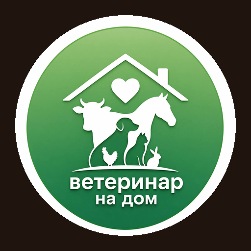

<p align="center">
  
</p>

<h1 align="center">🟢 ВетДом — приложение для клиентов (веб + мобильное) и сервер</h1>

**«Ветеринар на дом»** — платформа вызова ветеринара на дом. Этот репозиторий — **веб-версия и мобильное приложение для клиентов** (владельцев питомцев) и общий **сервер (API и база данных)**, с которым работают все продукты ВетДом.

> Мы приезжаем раньше, чем становится поздно. Ваш питомец — дома. Врач — уже в пути.

---

## Экосистема ВетДом

| Продукт | Для кого | Где лежит | Как открыть |
|---|---|---|---|
| 🌐 **Веб-версия для клиентов** | владельцы питомцев | этот репозиторий, `artifacts/veterinarathome/client` | в браузере компьютера: `http://localhost:5173` |
| 📱 **Мобильное приложение для клиентов** | владельцы питомцев | тот же код (PWA) — на телефоне сайт сам превращается в приложение с вкладками | на телефоне та же ссылка, или на компьютере в рамке телефона: `/phone.html` |
| 🩺 **Веб-версия для ветеринаров** | врачи | [VetWeb-Veterinar](https://github.com/arondrotsild-lab/VetWeb-Veterinar) | `http://localhost:5174` |
| 📲 **Мобильное приложение для ветеринаров** | врачи | [VetWeb-Veterinar](https://github.com/arondrotsild-lab/VetWeb-Veterinar) (тот же код, PWA) | на телефоне, или в рамке телефона: `http://localhost:5174/phone.html` |
| ⚙️ **Сервер и база данных** | все продукты | этот репозиторий, `artifacts/veterinarathome/server` | API `http://localhost:3001` |
| CRM / админ-панель | команда ВетДом | планируется | — |

**Языки:** русский, English, Türkçe, العربية — кнопка с флагом вверху справа во всех приложениях.

Все продукты используют **один сервер и одну базу данных** из этого репозитория: заказ клиента сразу виден врачу и в CRM.

---

## Возможности для клиентов

| | Функция | Что делает |
|---|---|---|
| 🚑 | **Вызов ветеринара** | Выбор услуги, питомца, адреса и времени. Врач приезжает за 15–60 минут |
| 🎤 | **ИИ-помощник первой помощи** | Клиент наговаривает, что случилось; голос расшифровывается (Whisper), ИИ даёт срочность и советы до приезда врача; рассказ и голосовое передаются врачу |
| 🗺 | **Живая карта** | Поиск врача, «Я выезжаю», движение машины по реальному маршруту, осмотр, оплата |
| 📘 | **Ветеринарный паспорт** | Уникальный ID питомца, прививки, путешествия, вес, история визитов, поиск по ID |
| 💬 | **Чат с ветеринаром** | Переписка и голосовые сообщения с расшифровкой после визита |
| 🎁 | **Бонусы и рефералы** | Кешбэк 10–15%, оплата бонусами до 30% визита, +500 за друга и 5% с его визитов |
| 🛍 | **Магазин** | Корма собственного производства «ВетДом Натурал», препараты, амуниция, игрушки — за рубли или бонусы |
| ❤️ | **Благотворительность** | Сбор на лечение животных из приютов, «карма добра» |
| 📱 | **Мобильная версия** | Устанавливается на телефон как приложение (PWA): главный экран, вкладки, переходы |

---

## Технологии

- **Клиент:** React 18, TypeScript, Vite, Tailwind CSS, Leaflet (карта), i18next (RU / EN / TR / AR)
- **Сервер:** Node.js, Express, TypeScript, PostgreSQL
- **ИИ:** Claude API (оценка состояния питомца), whisper.cpp (расшифровка речи на сервере)
- **Мобильное приложение:** PWA + Capacitor (в репозитории [VETWEB-mobile](https://github.com/arondrotsild-lab/VETWEB-mobile))

## Структура

```
artifacts/veterinarathome/      ← приложение ВетДом
├── client/                     веб-клиент (React)
│   ├── src/pages/              экраны: главная, заказ, карта, паспорт, магазин, чат…
│   ├── src/components/         карта, голосовой ввод, нижнее меню приложения…
│   └── public/                 фото, иконки приложения, manifest для установки
├── server/                     API и база данных (Express + PostgreSQL)
│   └── src/routes/             auth, orders, pets, loyalty, shop, chat, charity, triage…
└── dev-local.sh                запуск на своём компьютере
```

Остальные папки в корне (`lib/`, `artifacts/api-server`, `artifacts/mockup-sandbox`) — шаблон рабочего пространства Replit, приложение их не использует.

## Запуск на своём компьютере

Нужны: Node.js 20+, PostgreSQL 16. Для расшифровки голоса — `whisper-cpp` и `ffmpeg` (на Mac: `brew install whisper-cpp ffmpeg`).

```bash
cd artifacts/veterinarathome
npm ci --prefix server && npm ci --prefix client
createdb vetdom
```

Создайте файл `artifacts/veterinarathome/.env` (он не попадает в Git):

```env
DATABASE_URL=postgresql://<пользователь>@localhost:5432/vetdom
SESSION_SECRET=<длинная случайная строка>
# ANTHROPIC_API_KEY=...   — для ИИ-помощника (без ключа работает резервный режим)
```

Модель распознавания речи (≈190 МБ) положите в `server/models/ggml-small-q5_1.bin`
(скачать: huggingface.co/ggerganov/whisper.cpp).

```bash
./dev-local.sh
```

Сайт откроется на **http://localhost:5173**. При первом запуске сервер сам создаст таблицы и демо-данные.

### Демо-доступ
На странице входа — кнопка **«Быстрый вход»** (аккаунт с питомцами, заказами, бонусами и чатами).
Мобильная версия в рамке телефона: **http://localhost:5173/phone.html**

## Безопасность

Секреты (`.env`), голосовые записи (`server/uploads/`), модель распознавания (`server/models/`) и кэш карты (`server/tile-cache/`) исключены из Git.

---

© 2026 ВетДом — ветеринар на дом. Все права защищены.
